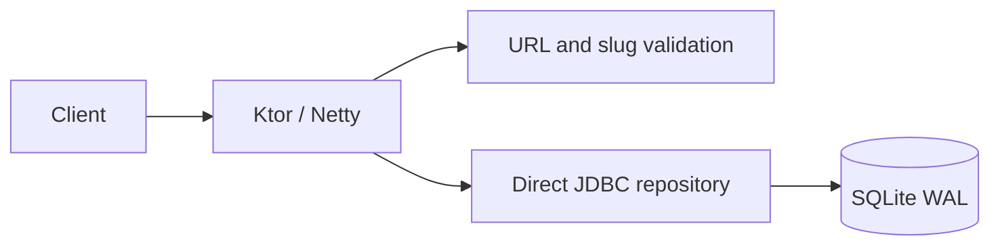

# KURL

[](https://github.com/toptoppy/kurl/actions/workflows/ci.yml)
[](LICENSE)

A small, self-hosted URL shortener built with Kotlin, Ktor, SQLite, and GraalVM Native Image. KURL uses direct JDBC rather than a reflection-heavy ORM.

## Quick start

```sh
docker run --rm -p 8080:8080 -v kurl-data:/app/data ghcr.io/toptoppy/kurl:latest
```

Open `http://localhost:8080/health` to check the service. To create a short URL:

```sh
curl -i http://localhost:8080/api/shorten \
  -H 'Content-Type: application/json' \
  -d '{"url":"https://example.com/a/long/path"}'
```

Set `API_KEY` to require the `X-Api-Key` header for URL creation and statistics. Redirects and health checks remain public.

The image stores SQLite data in `/app/data`. The quick start uses a named volume. For a bind mount, give the folder to the distroless non-root UID:

```sh
mkdir -p data
sudo chown 65532:65532 data
docker run --rm -p 8080:8080 -v "$PWD/data:/app/data" ghcr.io/toptoppy/kurl:latest
```

## Configuration

| Variable | Default | Purpose |
| --- | --- | --- |
| `PORT` | `8080` | HTTP listen port |
| `DATABASE_PATH` | `./data/kurl.db` | SQLite database file |
| `BASE_URL` | `http://localhost:8080` | Public prefix used in create responses |
| `API_KEY` | unset | Optional key required for create and stats endpoints |

## API

See [docs/api.md](docs/api.md) for request and response examples.

## Build and test

Requires JDK 21. GraalVM 25 Native Image is additionally required for a local native build; the application bytecode target remains Java 21.

```sh
./gradlew test
./gradlew run
./gradlew nativeCompile
```

## Architecture



The repository serializes writes while allowing independent connections for reads. URL validation rejects local and private destinations at creation time. This check is not a guarantee about where a browser will resolve a hostname later; see [docs/architecture.md](docs/architecture.md#url-safety).

## Project status

KURL is experimental. Native-image compatibility, resource use, startup time, and container size must be measured on the target platform before being treated as guarantees.

## License

MIT. See [LICENSE](LICENSE).
